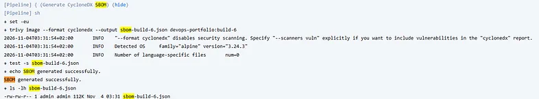
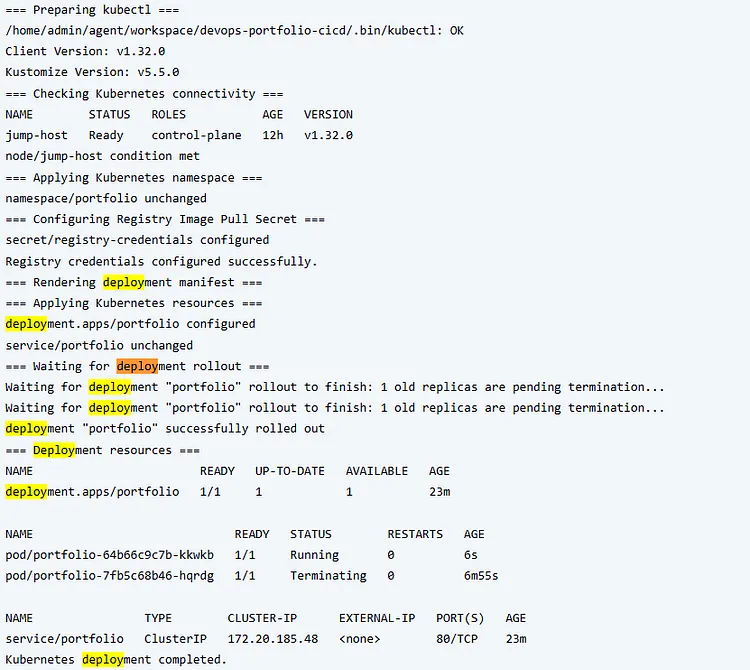

Membangun End-to-End DevSecOps Pipeline Menggunakan Jenkins, Docker, Trivy, Kubernetes, Prometheus, dan Grafana

Pendahuluan

Proses deployment aplikasi tidak berhenti setelah aplikasi berhasil dibuat dan dapat diakses. Dalam workflow DevOps, proses build, pengujian keamanan, distribusi artefak, deployment, dan monitoring perlu dikelola secara konsisten. Pemeriksaan keamanan juga perlu menjadi bagian dari alur tersebut, bukan hanya dilakukan setelah aplikasi berjalan.

Project ini merupakan implementasi end-to-end DevSecOps menggunakan aplikasi portfolio website sederhana berbasis HTML dan CSS. Aplikasi disajikan menggunakan Nginx, dikemas ke dalam Docker image, lalu diproses melalui pipeline Jenkins.

Pipeline mengintegrasikan Trivy untuk memeriksa filesystem dan Docker image. Trivy juga digunakan untuk menghasilkan Software Bill of Materials (SBOM) dalam format CycloneDX. Setelah pemeriksaan selesai, image dikirim ke private Docker Registry dan digunakan oleh Kubernetes untuk menjalankan aplikasi.

Untuk kebutuhan monitoring, Prometheus mengumpulkan metrics dari host dan Kubernetes. Node Exporter menyediakan metrics host, sedangkan kube-state-metrics, Kubelet, dan cAdvisor menyediakan informasi mengenai kondisi resource Kubernetes. Metrics tersebut kemudian divisualisasikan melalui Grafana.

Implementasi dilakukan pada environment KodeKloud Playground. Karena environment Playground bersifat sementara, repository GitHub digunakan sebagai tempat penyimpanan source code, manifest, pipeline, konfigurasi monitoring, dan dokumentasi project

Tujuan Project
Mengotomatisasi build dan deployment aplikasi menggunakan Jenkins.
Mengintegrasikan security scanning ke dalam CI/CD pipeline.
Menghasilkan Software Bill of Materials (SBOM).
Mengelola Docker image melalui private registry.
Melakukan deployment aplikasi menggunakan Kubernetes.
Membangun monitoring untuk host dan Kubernetes.
Arsitektur Project

Alur dimulai ketika source code disimpan pada repository GitHub. Jenkins mengambil repository melalui konfigurasi Pipeline from SCM, kemudian menjalankan tahapan yang didefinisikan pada Jenkinsfile.

Pada tahap CI, Jenkins melakukan validasi awal dan filesystem scanning menggunakan Trivy. Jika tahap tersebut berhasil, Jenkins membangun Docker image. Image yang dihasilkan kemudian diperiksa kembali menggunakan Trivy sebelum SBOM CycloneDX dibuat.

Setelah pemeriksaan selesai, Jenkins mengirim image ke private Docker Registry. Jenkins juga mengakses Kubernetes menggunakan kubeconfig yang disimpan pada Jenkins Credentials. Pipeline menyiapkan registry pull secret, menerapkan manifest aplikasi, dan menunggu proses rollout selesai.

Pada sisi monitoring, Prometheus mengumpulkan metrics dari Node Exporter, kube-state-metrics, Kubelet, dan cAdvisor. Grafana menggunakan Prometheus sebagai data source untuk menampilkan kondisi host dan workload Kubernetes.

Step 1 — Membangun Portfolio Website

Aplikasi yang digunakan dalam project ini adalah portfolio website yang dikembangkan menggunakan HTML dan CSS. Website menampilkan informasi profil, keahlian teknis, beberapa project, serta informasi kontak.

Aplikasi dibuat secara sederhana karena fokus utama project ini adalah penerapan proses DevOps dan DevSecOps, bukan pengembangan fitur aplikasi yang kompleks.

Step 2 — Containerization Menggunakan Docker
Setelah aplikasi selesai dibuat, langkah berikutnya adalah mengemas aplikasi ke dalam Docker image.

Project ini menggunakan Nginx sebagai web server untuk menyajikan file HTML dan CSS. Konfigurasi image dibuat melalui Dockerfile agar proses build dapat dijalankan secara konsisten.

Build Docker Image
Proses build dilakukan melalui Jenkins agent pada Docker Host menggunakan Dockerfile yang telah disiapkan.

Verifikasi Docker Image

Step 3 — Konfigurasi Private Docker Registry
Docker image yang telah dibangun perlu disimpan pada registry agar dapat digunakan oleh lingkungan deployment.

Pada project ini, private Docker Registry tersedia pada alamat:

docker-host:5000
Registry tersebut digunakan sebagai tempat penyimpanan image aplikasi sebelum ditarik oleh Kubernetes.

Push Docker Image

Step 4 — Konfigurasi Jenkins
Jenkins digunakan untuk menjalankan seluruh tahapan CI/CD secara otomatis. Konfigurasi pipeline menggunakan pendekatan Pipeline from SCM, sehingga definisi pipeline disimpan bersama source code dalam repository GitHub.

Dalam implementasi ini, Jenkins menggunakan arsitektur Controller dan Agent. Jenkins Controller bertugas mengelola job dan pipeline, sedangkan proses build dan operasi Docker dijalankan melalui agent pada Docker Host.

Jenkins Configuration

Job yang digunakan bernama devops-portfolio-cicd. Konfigurasi pipeline diarahkan ke repository GitHub dengan branch main dan file Jenkinsfile sebagai pipeline definition.

Jenkins Credentials

Beberapa credential digunakan untuk menghubungkan Jenkins dengan layanan eksternal dan kebutuhan deployment.

Credential yang digunakan meliputi:

docker-registry-creds untuk autentikasi ke private Docker Registry.
my-kube-config-credentials untuk mengakses Kubernetes menggunakan kubeconfig
Credential disimpan melalui Jenkins Credentials dan dipanggil berdasarkan ID dari dalam pipeline. Nilai username, password, token, dan isi kubeconfig tidak ditampilkan dalam dokumentasi.

Pipeline from SCM
Jenkins mengambil Jenkinsfile secara langsung dari repository GitHub. Dengan konfigurasi ini, perubahan pipeline dapat dikelola menggunakan Git dan mengikuti version control yang sama dengan aplikasi.

Step 5 — Membangun DevSecOps CI/CD Pipeline

Pipeline Stages
Pipeline terdiri dari beberapa tahapan berikut:

Checkout and Validate — mengambil source code dari repository GitHub dan melakukan pemeriksaan awal.
Trivy Filesystem Scan — memeriksa filesystem untuk menemukan vulnerability, secret, dan misconfiguration.
Build Docker Image — membangun image aplikasi menggunakan Dockerfile.
Trivy Image Scan — melakukan pemeriksaan vulnerability terhadap Docker image yang telah dibuat.
Generate CycloneDX SBOM — menghasilkan Software Bill of Materials dari Docker image.
Push to Private Registry — mengirim image ke private Docker Registry.
Deploy to Kubernetes — memperbarui konfigurasi deployment dan menjalankan aplikasi pada Kubernetes.

Implementasi Jenkinsfile

Step 6 — Security Scanning Menggunakan Trivy
Security scanning menjadi bagian dari pipeline untuk memeriksa potensi masalah keamanan sebelum image digunakan dalam proses deployment.

Project ini menggunakan Trivy untuk melakukan dua jenis pemeriksaan, yaitu filesystem scanning dan container image scanning.

Filesystem Scanning

Step 7 — Generate SBOM Menggunakan CycloneDX
Selain security scanning, pipeline juga menghasilkan Software Bill of Materials (SBOM).

SBOM merupakan daftar komponen perangkat lunak yang terdapat dalam suatu artefak. Informasi ini berguna untuk inventarisasi komponen dan membantu analisis risiko pada software supply chain.

Pada project ini, Trivy digunakan untuk menghasilkan SBOM dalam format CycloneDX.

Generate SBOM
Pembuatan SBOM dilakukan setelah proses image scanning selesai. File SBOM yang dihasilkan disimpan sebagai build artifact Jenkins sehingga dapat diakses kembali setelah pipeline selesai dijalankan.

Step 8 — Deployment Aplikasi ke Kubernetes
Setelah Docker image berhasil dikirim ke private registry, Jenkins melanjutkan proses deployment ke Kubernetes.

Cluster yang digunakan berjalan pada environment KodeKloud Playground. Aplikasi ditempatkan pada namespace portfolio.

Kubernetes Manifest

Deployment
Karena image disimpan pada private registry, Kubernetes membutuhkan kredensial untuk melakukan pull image.

Jenkins secara otomatis membuat atau memperbarui Secret bernama registry-credentials pada namespace portfolio.

Secret tersebut digunakan oleh Deployment ketika Kubernetes mengambil image dari registry.

Step 9— Monitoring Menggunakan Prometheus
Monitoring digunakan untuk mengamati kondisi host dan Kubernetes setelah aplikasi berhasil dijalankan.

Prometheus dipasang pada jump-host dan dikonfigurasi sebagai metrics collector. Prometheus mengambil metrics dari berbagai endpoint yang telah didaftarkan pada konfigurasi scrape.

Verifikasi Prometheus
Setelah aplikasi berhasil dijalankan, monitoring dikonfigurasi untuk mengamati kondisi host dan Kubernetes.

Prometheus dipasang pada jump-host dan dijalankan sebagai systemd service. Konfigurasi scrape disimpan dalam file:

/etc/prometheus/prometheus.yml
Prometheus mengumpulkan metrics dari beberapa endpoint yang didaftarkan dalam konfigurasi tersebut.

Step 10 — Host Monitoring Menggunakan Node Exporter
Node Exporter digunakan untuk menyediakan metrics terkait kondisi sistem operasi dan resource host.

Metrics tersebut kemudian dikumpulkan oleh Prometheus untuk kebutuhan monitoring.

Beberapa metrics yang digunakan dalam dashboard meliputi:

CPU utilization.
Memory usage dan available memory.
Filesystem usage.
Disk read dan write.
Network traffic.
System load average.
Host uptime.

Step 11 — Kubernetes Monitoring

Kubernetes Monitoring
Monitoring Kubernetes menggabungkan beberapa sumber metrics karena setiap komponen menyediakan informasi yang berbeda.

kube-state-metrics

kube-state-metrics menyediakan metrics berdasarkan kondisi objek Kubernetes, seperti Pod, Deployment, Namespace, dan Node. Metrics ini digunakan untuk melihat status serta ketersediaan resource Kubernetes.

Kubelet

Kubelet menyediakan metrics dari node dan aktivitas container. Pada implementasi ini, endpoint metrics Kubelet diakses melalui Kubernetes API proxy.

cAdvisor

cAdvisor menyediakan metrics penggunaan resource container, termasuk CPU dan memory. Metrics tersebut digunakan untuk melihat konsumsi resource workload.

Akses Prometheus ke endpoint Kubelet dan cAdvisor menggunakan Service Account khusus dengan izin RBAC yang diperlukan. Token dan sertifikat CA disimpan pada host Prometheus dan tidak dimasukkan ke repository.

Step 12 — Visualisasi Monitoring Menggunakan Grafana
Grafana digunakan untuk menampilkan metrics yang dikumpulkan Prometheus dalam bentuk dashboard.

Prometheus ditambahkan sebagai data source Grafana, kemudian dashboard dibuat untuk memisahkan pemantauan host dan Kubernetes.

Kubernetes Monitoring Dashboard
Dashboard Kubernetes Monitoring digunakan untuk melihat kondisi workload dan penggunaan resource container.

Panel yang ditampilkan meliputi:

Total Pods.
Running Pods.
Pods Not Running.
Node Ready.
Deployment Availability.
Container Restarts.
Container CPU Usage by Pod.
Container Memory Working Set.
Pod Status by Phase.

Dashboard ini menggabungkan metrics dari kube-state-metrics, Kubelet, dan cAdvisor. Informasi tersebut membantu memberikan gambaran mengenai kondisi workload dan penggunaan resource pada cluster.

Kesimpulan

Project ini menghasilkan implementasi workflow DevSecOps yang menghubungkan source code management, CI/CD automation, security scanning, SBOM generation, containerization, deployment Kubernetes, dan monitoring.

Jenkins digunakan untuk mengotomatisasi proses dari checkout source code hingga deployment. Trivy menjadi bagian dari pipeline untuk memeriksa filesystem dan Docker image, sementara SBOM dalam format CycloneDX disimpan sebagai build artifact. Docker image didistribusikan melalui private registry sebelum digunakan oleh Kubernetes.

Pada sisi monitoring, Prometheus mengumpulkan metrics dari host dan Kubernetes. Grafana kemudian menyajikan metrics tersebut melalui dashboard host monitoring dan Kubernetes monitoring.

Dari implementasi ini, saya mendapatkan pengalaman dalam mengintegrasikan beberapa komponen DevOps dan DevSecOps ke dalam satu workflow, termasuk pengelolaan Jenkins credentials, private registry, Kubernetes Image Pull Secret, RBAC untuk monitoring, dan dashboard observability.

GitHub Repository
Repository project:

https://github.com/RichardAkbar/devops-project-cicd
