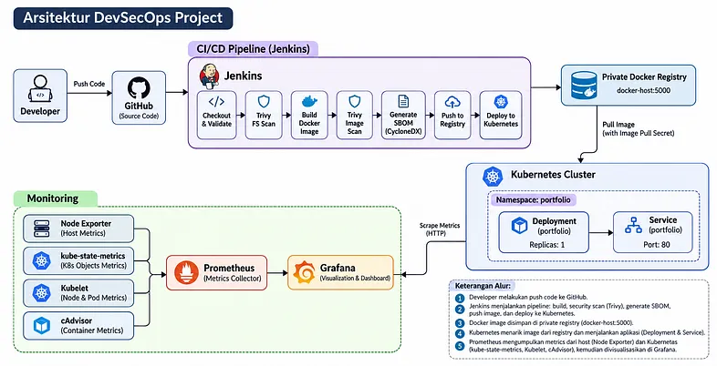

Pendahuluan
Pada project ini, saya membangun sebuah pipeline DevSecOps untuk mengotomatisasi proses build, security scanning, containerization, dan deployment aplikasi ke Kubernetes.

Aplikasi yang digunakan adalah portfolio website sederhana berbasis HTML dan CSS dengan Nginx sebagai web server. Aplikasi ini menjadi media untuk menerapkan integrasi beberapa tools DevOps dan DevSecOps dalam satu workflow.

Jenkins digunakan untuk mengelola proses CI/CD. Trivy digunakan untuk memeriksa keamanan source code dan Docker image, sedangkan Trivy juga dimanfaatkan untuk menghasilkan SBOM dalam format CycloneDX. Docker digunakan untuk membangun image aplikasi, kemudian image disimpan pada private Docker Registry sebelum digunakan oleh Kubernetes.

Selain proses deployment, project ini juga mencakup monitoring host dan Kubernetes menggunakan Prometheus, Node Exporter, kube-state-metrics, Kubelet, dan cAdvisor. Metrics yang dikumpulkan kemudian divisualisasikan melalui Grafana.

Tujuan Project
Mengotomatisasi build dan deployment aplikasi menggunakan Jenkins.
Mengintegrasikan security scanning ke dalam CI/CD pipeline.
Menghasilkan Software Bill of Materials (SBOM).
Mengelola Docker image melalui private registry.
Melakukan deployment aplikasi menggunakan Kubernetes.
Membangun monitoring untuk host dan Kubernetes.
Arsitektur Project

Arsitektur tersebut menggambarkan alur implementasi project, mulai dari source code yang disimpan di GitHub, proses CI/CD melalui Jenkins, pemeriksaan keamanan menggunakan Trivy, hingga deployment aplikasi ke Kubernetes.

Docker image disimpan pada private registry sebelum digunakan oleh Kubernetes. Sementara itu, Prometheus mengumpulkan metrics dari host dan komponen Kubernetes untuk ditampilkan melalui dashboard Grafana.

Step 1 — Membangun Portfolio Website
weeb view.png

Aplikasi yang digunakan dalam project ini adalah portfolio website yang dikembangkan menggunakan HTML dan CSS. Website menampilkan informasi profil, keahlian teknis, beberapa project, serta informasi kontak.

Aplikasi dibuat secara sederhana karena fokus utama project ini adalah penerapan proses DevOps dan DevSecOps, bukan pengembangan fitur aplikasi yang kompleks.

Step 2 — Containerization Menggunakan Docker
Setelah aplikasi selesai dibuat, langkah berikutnya adalah mengemas aplikasi ke dalam Docker image.

Project ini menggunakan Nginx sebagai web server untuk menyajikan file HTML dan CSS. Konfigurasi image dibuat melalui Dockerfile agar proses build dapat dijalankan secara konsisten.

Build Docker Image
Proses build dilakukan melalui Jenkins agent pada Docker Host menggunakan Dockerfile yang telah disiapkan.

Verifikasi Docker Image

Step 3 — Konfigurasi Private Docker Registry
Docker image yang telah dibangun perlu disimpan pada registry agar dapat digunakan oleh lingkungan deployment.

Pada project ini, private Docker Registry tersedia pada alamat:

docker-host:5000
Registry tersebut digunakan sebagai tempat penyimpanan image aplikasi sebelum ditarik oleh Kubernetes.

Push Docker Image

Step 4 — Konfigurasi Jenkins
Jenkins digunakan untuk menjalankan seluruh tahapan CI/CD secara otomatis. Konfigurasi pipeline menggunakan pendekatan Pipeline from SCM, sehingga definisi pipeline disimpan bersama source code dalam repository GitHub.

Dalam implementasi ini, Jenkins menggunakan arsitektur Controller dan Agent. Jenkins Controller bertugas mengelola job dan pipeline, sedangkan proses build dan operasi Docker dijalankan melalui agent pada Docker Host.

Jenkins Configuration

Job yang digunakan bernama devops-portfolio-cicd. Konfigurasi pipeline diarahkan ke repository GitHub dengan branch main dan file Jenkinsfile sebagai pipeline definition.

Jenkins Credentials

Beberapa credential digunakan untuk menghubungkan Jenkins dengan layanan eksternal dan kebutuhan deployment.

Credential yang digunakan meliputi:

docker-registry-creds untuk autentikasi ke private Docker Registry.
my-kube-config-credentials untuk mengakses Kubernetes menggunakan kubeconfig
Credential disimpan melalui Jenkins Credentials dan dipanggil berdasarkan ID dari dalam pipeline. Nilai username, password, token, dan isi kubeconfig tidak ditampilkan dalam dokumentasi.

Pipeline from SCM
Jenkins mengambil Jenkinsfile secara langsung dari repository GitHub. Dengan konfigurasi ini, perubahan pipeline dapat dikelola menggunakan Git dan mengikuti version control yang sama dengan aplikasi.

Press enter or click to view image in full size

Step 5 — Membangun DevSecOps CI/CD Pipeline
Jelaskan bagaimana Jenkins menjalankan setiap tahapan pipeline secara otomatis.

Pipeline Stages
Pipeline terdiri dari beberapa tahapan berikut:

Checkout and Validate — mengambil source code dari repository GitHub dan melakukan pemeriksaan awal.
Trivy Filesystem Scan — memeriksa filesystem untuk menemukan vulnerability, secret, dan misconfiguration.
Build Docker Image — membangun image aplikasi menggunakan Dockerfile.
Trivy Image Scan — melakukan pemeriksaan vulnerability terhadap Docker image yang telah dibuat.
Generate CycloneDX SBOM — menghasilkan Software Bill of Materials dari Docker image.
Push to Private Registry — mengirim image ke private Docker Registry.
Deploy to Kubernetes — memperbarui konfigurasi deployment dan menjalankan aplikasi pada Kubernetes.
Implementasi Jenkinsfile
Press enter or click to view image in full size

Step 6 — Security Scanning Menggunakan Trivy
Security scanning menjadi bagian dari pipeline untuk memeriksa potensi masalah keamanan sebelum image digunakan dalam proses deployment.

Project ini menggunakan Trivy untuk melakukan dua jenis pemeriksaan, yaitu filesystem scanning dan container image scanning.

Filesystem Scanning
Press enter or click to view image in full size

Step 7 — Generate SBOM Menggunakan CycloneDX
Selain security scanning, pipeline juga menghasilkan Software Bill of Materials (SBOM).

Write on Medium
Subscribe to Pro Writer Tools to remove upgrade prompts from your unlocked stories.

SBOM merupakan daftar komponen perangkat lunak yang terdapat dalam suatu artefak. Informasi ini berguna untuk inventarisasi komponen dan membantu analisis risiko pada software supply chain.

Pada project ini, Trivy digunakan untuk menghasilkan SBOM dalam format CycloneDX.

Generate SBOM
Pembuatan SBOM dilakukan setelah proses image scanning selesai. File SBOM yang dihasilkan disimpan sebagai build artifact Jenkins sehingga dapat diakses kembali setelah pipeline selesai dijalankan.

Press enter or click to view image in full size

Step 8 — Deployment Aplikasi ke Kubernetes
Setelah Docker image berhasil dikirim ke private registry, Jenkins melanjutkan proses deployment ke Kubernetes.

Cluster yang digunakan berjalan pada environment KodeKloud Playground. Aplikasi ditempatkan pada namespace portfolio.

Kubernetes Manifest
Press enter or click to view image in full size

Deployment
Karena image disimpan pada private registry, Kubernetes membutuhkan kredensial untuk melakukan pull image.

Jenkins secara otomatis membuat atau memperbarui Secret bernama registry-credentials pada namespace portfolio.

Secret tersebut digunakan oleh Deployment ketika Kubernetes mengambil image dari registry.

Press enter or click to view image in full size

Step 9— Monitoring Menggunakan Prometheus
Monitoring digunakan untuk mengamati kondisi host dan Kubernetes setelah aplikasi berhasil dijalankan.

Prometheus dipasang pada jump-host dan dikonfigurasi sebagai metrics collector. Prometheus mengambil metrics dari berbagai endpoint yang telah didaftarkan pada konfigurasi scrape.

Verifikasi Prometheus
Setelah aplikasi berhasil dijalankan, monitoring dikonfigurasi untuk mengamati kondisi host dan Kubernetes.

Prometheus dipasang pada jump-host dan dijalankan sebagai systemd service. Konfigurasi scrape disimpan dalam file:

/etc/prometheus/prometheus.yml
Prometheus mengumpulkan metrics dari beberapa endpoint yang didaftarkan dalam konfigurasi tersebut.

Press enter or click to view image in full size

Step 10 — Host Monitoring Menggunakan Node Exporter
Node Exporter digunakan untuk menyediakan metrics terkait kondisi sistem operasi dan resource host.

Metrics tersebut kemudian dikumpulkan oleh Prometheus untuk kebutuhan monitoring.

Beberapa metrics yang digunakan dalam dashboard meliputi:

CPU utilization.
Memory usage dan available memory.
Filesystem usage.
Disk read dan write.
Network traffic.
System load average.
Host uptime.
Step 11 — Kubernetes Monitoring
Monitoring Kubernetes dilakukan dengan mengintegrasikan beberapa sumber metrics ke dalam Prometheus. Setiap komponen menyediakan informasi yang berbeda mengenai kondisi cluster dan workload.

kube-state-metrics
kube-state-metrics digunakan untuk menyediakan metrics berdasarkan kondisi objek Kubernetes, seperti Pod, Deployment, Namespace, dan Node.

Metrics ini membantu memantau status resource yang berjalan di dalam cluster.

Kubelet dan cAdvisor
Kubelet menyediakan informasi terkait kondisi node dan aktivitas container. Sementara itu, cAdvisor menyediakan metrics penggunaan resource container, termasuk CPU dan memory.

Pada project ini, metrics Kubelet dan cAdvisor diambil melalui Kubernetes API proxy. Service Account khusus dibuat untuk memberikan izin akses yang dibutuhkan Prometheus.

Step 12 — Visualisasi Monitoring Menggunakan Grafana
Grafana digunakan untuk menampilkan metrics yang dikumpulkan Prometheus dalam bentuk dashboard.

Prometheus ditambahkan sebagai data source Grafana, kemudian dashboard dibuat untuk memisahkan pemantauan host dan Kubernetes.

Host Monitoring Dashboard
Press enter or click to view image in full size

Kubernetes Monitoring Dashboard
Dashboard Kubernetes Monitoring digunakan untuk melihat kondisi workload dan penggunaan resource container.

Panel yang ditampilkan meliputi:

Total Pods.
Running Pods.
Pods Not Running.
Node Ready.
Deployment Availability.
Container Restarts.
Container CPU Usage by Pod.
Container Memory Working Set.
Pod Status by Phase.
Kesimpulan
Project ini mengimplementasikan workflow DevSecOps yang menghubungkan source code management, CI/CD automation, security scanning, SBOM generation, containerization, deployment Kubernetes, dan monitoring.

Jenkins digunakan untuk mengotomatisasi proses build hingga deployment. Trivy diintegrasikan sebagai bagian dari security gate, sementara SBOM dalam format CycloneDX disimpan sebagai build artifact. Docker image didistribusikan melalui private registry sebelum digunakan oleh Kubernetes.

Pada sisi monitoring, Prometheus mengumpulkan metrics dari host dan Kubernetes, kemudian Grafana digunakan untuk menyajikan informasi tersebut melalui dashboard.

Melalui implementasi ini, saya mendapatkan pengalaman dalam mengintegrasikan berbagai komponen DevOps dan DevSecOps ke dalam satu workflow, termasuk pengelolaan credentials, private registry, Kubernetes deployment, dan monitoring.

GitHub Repository
Repository project:

https://github.com/RichardAkbar/devops-project-cicd

Repository berisi source code aplikasi, Dockerfile, Jenkinsfile, Kubernetes manifests, konfigurasi monitoring, dashboard Grafana, dan dokumentasi project.